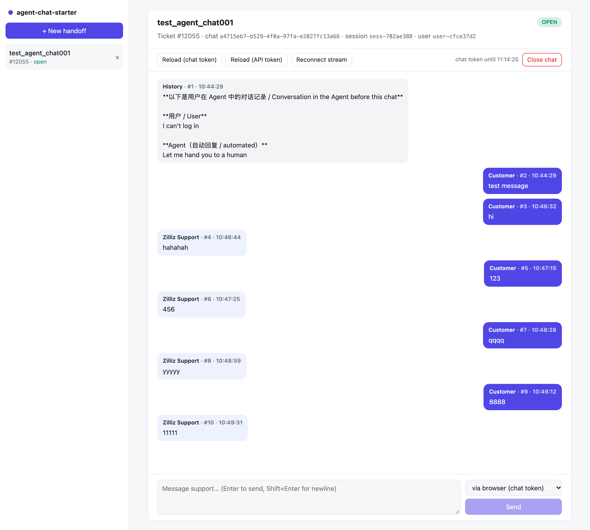
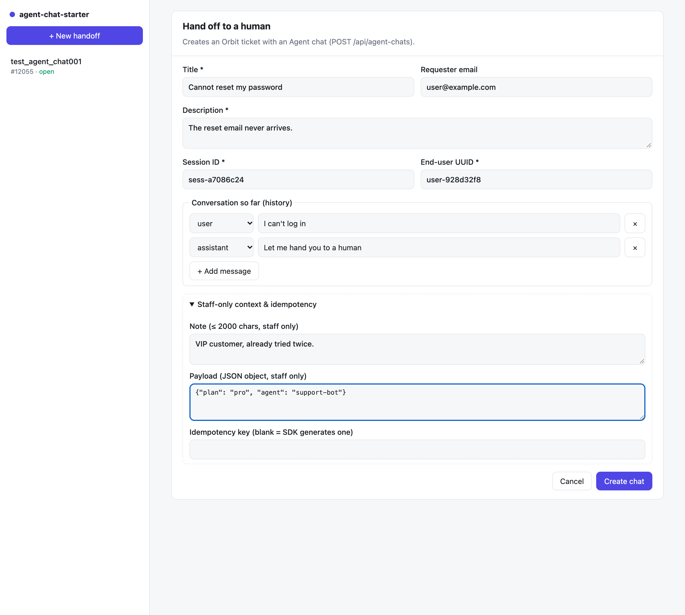
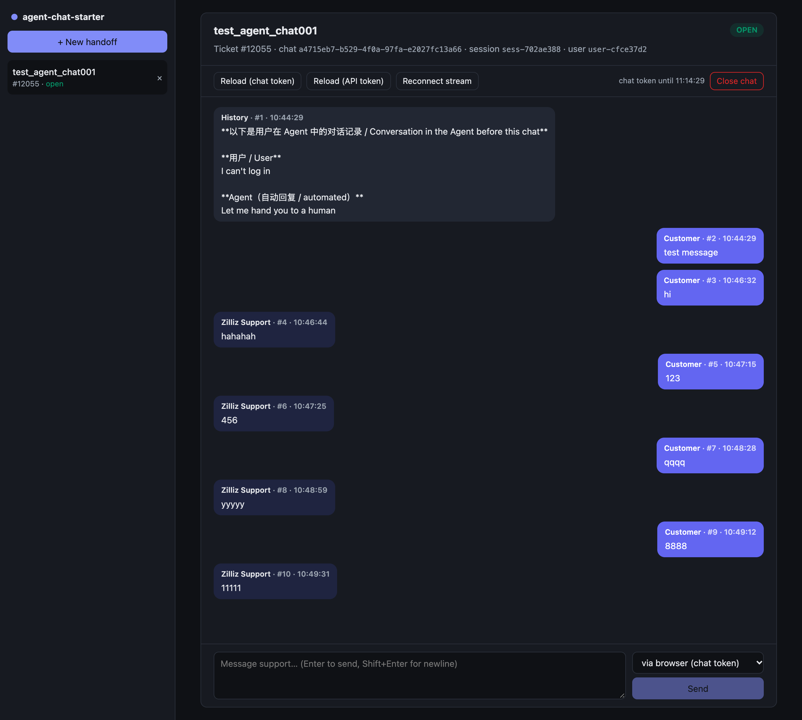
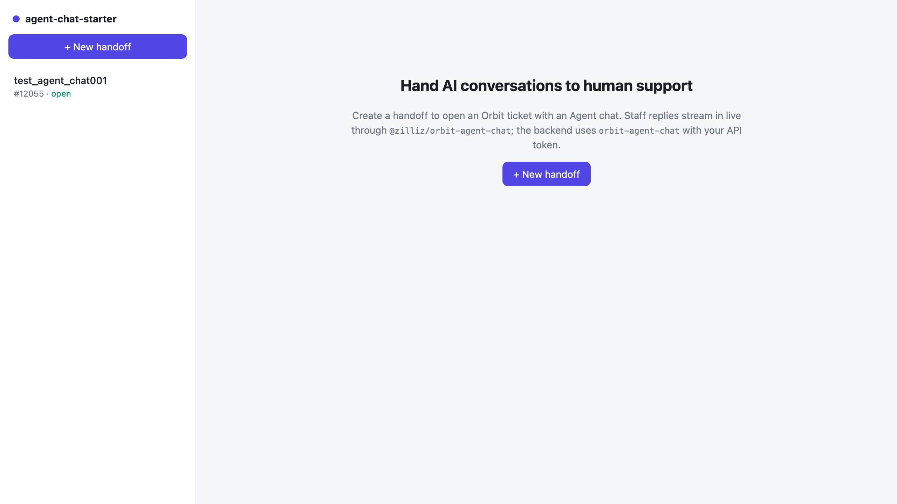

# agent-chat-starter

[English](#english) · [中文](#中文)

A minimal, runnable example of handing an AI Agent conversation to human support staff in [Orbit](https://github.com/zilliztech/orbit) — Python backend + Next.js frontend.

一个最小可运行示例：把 AI Agent 的对话转交给 Orbit 人工客服 —— Python 后端 + Next.js 前端。

| Live chat with staff replies · 实时会话 | Hand off to a human · 创建转人工 |
| --- | --- |
|  |  |

| Dark mode · 暗色模式 | Home · 首页 |
| --- | --- |
|  |  |

---

## English

- **backend/** — Python (FastAPI) + [`orbit-agent-chat`](https://pypi.org/project/orbit-agent-chat/); holds the Orbit API token
- **frontend/** — Next.js + [`@zilliz/orbit-agent-chat`](https://www.npmjs.com/package/@zilliz/orbit-agent-chat); follows the realtime stream with a short-lived chat token

```
Browser (Next.js)                          Python backend (FastAPI)              Orbit
 ├─ /api/backend/* ──(Next rewrite)──▶   OrbitAgentChatClient ──Bearer API token──▶ /api/agent-chats/...
 └─ connectAgentChat ─── AgentChat <chat token> ── (direct, or via /orbit/* proxy) ──▶ /stream, /messages
```

### Orbit Agent Chat endpoints covered

| Orbit endpoint | Credential | In this project |
| --- | --- | --- |
| `POST /api/agent-chats` — create a chat (history, note, payload, requesterEmail, idempotency key) | API token | backend `POST /api/chats` → `create_chat`; frontend **New handoff** form |
| `POST /api/agent-chats/{id}/tokens` — issue a chat token | API token | backend `POST /api/chats/{id}/token` → `issue_token`; the frontend SDK's `getToken` |
| `POST /api/agent-chats/{id}/close` — close a chat | API token | backend `POST /api/chats/{id}/close` → `close_chat`; **Close chat** button |
| `GET /api/agent-chats/{id}/messages` — read history | API token / chat token | backend `GET /api/chats/{id}/messages` → `list_messages`; **Reload (API token)** / **Reload (chat token)** → `fetchHistory` |
| `POST /api/agent-chats/{id}/messages` — post a customer message | API token / chat token | backend `POST /api/chats/{id}/messages` → `send_message`; composer (*via browser* or *via backend*) |
| `GET /api/agent-chats/{id}/stream` — realtime push (SSE) | chat token | frontend `connectAgentChat`: auto-reconnect, token renewal, resume from `Last-Event-ID` |

Orbit has no "list chats" endpoint, so the backend remembers the chats it created in `backend/data/chats.json` (the sidebar). Replace it with your own database in production.

### Configuration

```bash
cp .env.example .env
```

Fill in the `.env` at the **repository root** (shared by backend and frontend):

| Variable | Description |
| --- | --- |
| `ORBIT_BASE_URL` | Orbit URL, e.g. `https://support.example.com` (a local Orbit is usually plain `http://127.0.0.1:4101`). Used by both SDKs |
| `ORBIT_API_TOKEN` | Orbit API token: console **API tokens** (`/internal/api-tokens`) → New token, type **API Client**, scope `agent_chat:write` only. Backend only — never sent to the browser |
| `ORBIT_BROWSER_PROXY` | `false` (default): the browser calls Orbit directly; an admin must add your page origin under **CORS Origins** (`/internal/cors-origins`) with use *Agent chat*. `true`: the browser goes through this app's `/orbit/*` streaming proxy — no CORS setup needed, handy for local development |
| `BACKEND_URL` / `BACKEND_PORT` | Backend address the frontend proxies to, default `http://127.0.0.1:8000` |
| `FRONTEND_ORIGIN` | Frontend origin allowed by the backend's CORS (default `http://localhost:3000`) |

> To change the token's secret, use **Rotate** on the same token in the Orbit console. A newly created token is a new integration: every existing chat would stop working.

### Run

Requires Python 3.10+ with [uv](https://docs.astral.sh/uv/), and Node 18+ with pnpm (or npm).

```bash
cd backend && uv sync && uv run uvicorn app.main:app --reload --port 8000
```

```bash
cd frontend && pnpm install && pnpm dev
```

Open http://localhost:3000 → **+ New handoff** → create. Reply on the ticket in the Orbit console and the staff message appears on the page in real time.

### Layout

```
backend/app/main.py                    FastAPI routes, all via AsyncOrbitAgentChatClient
backend/app/config.py                  reads the root .env
backend/app/store.py                   local chat index (JSON file)
frontend/next.config.ts                reads the root .env; /api/backend/* rewrite
frontend/app/orbit/[...path]/route.ts  optional same-origin streaming proxy to Orbit
frontend/lib/backend.ts                backend client; orbitBaseUrl()
frontend/components/                   ChatApp (list), NewChatForm (create), ChatPanel (live chat)
```

### Error handling

- The backend passes Orbit's HTTP status and `{ error: { code, message, requestId, details, retryAfter } }` through unchanged (network errors become 502).
- `getToken` throws a `fatal` `AgentChatError` on 401 / 403 / 404, so the SDK stops and reports through `onError`; other failures are retried with backoff.
- `send_message` is retried only on 429 so a message is never posted twice; after a `network_error`, reload to check whether it landed.

### Troubleshooting

| Symptom | Cause / fix |
| --- | --- |
| `network_error` … `SSL: WRONG_VERSION_NUMBER` | `ORBIT_BASE_URL` uses `https://` but the server speaks plain HTTP (e.g. local Orbit) — use `http://` |
| `network_error (0)` in the chat view | The browser is blocked by CORS: add your origin in Orbit's **CORS Origins** (*Agent chat*), or set `ORBIT_BROWSER_PROXY=true` |
| `401 api_token_required` | `ORBIT_API_TOKEN` is missing, revoked, or lacks `agent_chat:write` |
| HMR WebSocket fails on `127.0.0.1:3000` | Already allowed via `allowedDevOrigins`; restart `pnpm dev` after changing `next.config.ts` |

Restart both servers after editing `.env`.

---

## 中文

- **backend/** — Python (FastAPI) + [`orbit-agent-chat`](https://pypi.org/project/orbit-agent-chat/)，持有 Orbit API token
- **frontend/** — Next.js + [`@zilliz/orbit-agent-chat`](https://www.npmjs.com/package/@zilliz/orbit-agent-chat)，用短期 chat token 订阅实时流

```
浏览器 (Next.js)                          Python 后端 (FastAPI)                 Orbit
 ├─ /api/backend/* ──(Next rewrite)──▶  OrbitAgentChatClient ──Bearer API token──▶ /api/agent-chats/...
 └─ connectAgentChat ─── AgentChat <chat token> ──（直连，或经 /orbit/* 代理）──▶ /stream, /messages
```

### 覆盖的 Orbit Agent Chat 接口

| Orbit 接口 | 凭证 | 在本项目中 |
| --- | --- | --- |
| `POST /api/agent-chats` 创建会话（含 history / note / payload / requesterEmail / 幂等键） | API token | 后端 `POST /api/chats` → `create_chat`；前端「New handoff」表单 |
| `POST /api/agent-chats/{id}/tokens` 签发 chat token | API token | 后端 `POST /api/chats/{id}/token` → `issue_token`；前端 SDK 的 `getToken` |
| `POST /api/agent-chats/{id}/close` 关闭会话 | API token | 后端 `POST /api/chats/{id}/close` → `close_chat`；「Close chat」按钮 |
| `GET /api/agent-chats/{id}/messages` 读历史 | API token / chat token | 后端 `GET /api/chats/{id}/messages` → `list_messages`；「Reload (API token)」/「Reload (chat token)」→ `fetchHistory` |
| `POST /api/agent-chats/{id}/messages` 发客户消息 | API token / chat token | 后端 `POST /api/chats/{id}/messages` → `send_message`；输入框可选 *via browser* / *via backend* |
| `GET /api/agent-chats/{id}/stream` 实时推送 (SSE) | chat token | 前端 `connectAgentChat`：自动重连、token 续期、按 `Last-Event-ID` 断点续传 |

Orbit 没有「列出会话」接口，后端把自己创建过的会话记在 `backend/data/chats.json`（侧边栏列表），生产环境请换成你自己的数据库。

### 配置

```bash
cp .env.example .env
```

在**仓库根目录**的 `.env` 里填写（前后端共用这一个文件）：

| 变量 | 说明 |
| --- | --- |
| `ORBIT_BASE_URL` | Orbit 地址，如 `https://support.example.com`（本地 Orbit 通常是明文 `http://127.0.0.1:4101`）。两个 SDK 共用 |
| `ORBIT_API_TOKEN` | Orbit API token：控制台 **API tokens**（`/internal/api-tokens`）新建，类型 **API Client**，只勾 `agent_chat:write`。只在后端使用，不会下发到浏览器 |
| `ORBIT_BROWSER_PROXY` | `false`（默认）：浏览器直连 Orbit，需管理员在 **CORS Origins**（`/internal/cors-origins`）把前端 origin 加为 *Agent chat* 用途。`true`：浏览器经本应用的 `/orbit/*` 流式代理访问，免配 CORS，适合本地开发 |
| `BACKEND_URL` / `BACKEND_PORT` | 前端代理到的后端地址，默认 `http://127.0.0.1:8000` |
| `FRONTEND_ORIGIN` | 后端 CORS 放行的前端 origin（默认 `http://localhost:3000`） |

> 更换 token 的 secret 请在 Orbit 控制台对原 token 点 **Rotate**；新建一个 token 会被视为新的集成，已有会话将全部失效。

### 运行

需要 Python 3.10+ 与 [uv](https://docs.astral.sh/uv/)、Node 18+ 与 pnpm（或 npm）。

```bash
cd backend && uv sync && uv run uvicorn app.main:app --reload --port 8000
```

```bash
cd frontend && pnpm install && pnpm dev
```

打开 http://localhost:3000 → **+ New handoff** 填写并创建 → 在 Orbit 控制台对应工单里回复，客服消息会实时出现在页面上。

### 目录

```
backend/app/main.py                    FastAPI 路由，全部通过 AsyncOrbitAgentChatClient 调 Orbit
backend/app/config.py                  读取根目录 .env
backend/app/store.py                   本地会话索引（JSON 文件）
frontend/next.config.ts                读取根目录 .env；/api/backend/* 转发
frontend/app/orbit/[...path]/route.ts  可选的同源流式代理（转发到 Orbit）
frontend/lib/backend.ts                调后端的封装；orbitBaseUrl()
frontend/components/                   ChatApp（列表）、NewChatForm（创建）、ChatPanel（实时会话）
```

### 错误处理要点

- 后端把 Orbit 的 HTTP 状态码与 `{ error: { code, message, requestId, details, retryAfter } }` 原样透传（网络错误映射为 502）。
- `getToken` 遇到 401 / 403 / 404 抛出 `fatal` 的 `AgentChatError`，SDK 停止重连并通过 `onError` 报告；其他失败按退避自动重试。
- `send_message` 只在 429 时重试，避免重复发消息；遇到 `network_error` 可先 Reload 确认是否已送达。

### 常见问题

| 现象 | 原因 / 处理 |
| --- | --- |
| `network_error` … `SSL: WRONG_VERSION_NUMBER` | `ORBIT_BASE_URL` 写了 `https://`，但服务端是明文 HTTP（如本地 Orbit），改成 `http://` |
| 会话页显示 `network_error (0)` | 浏览器被 CORS 拦截：在 Orbit **CORS Origins** 加上前端 origin（*Agent chat* 用途），或设置 `ORBIT_BROWSER_PROXY=true` |
| `401 api_token_required` | `ORBIT_API_TOKEN` 未设置、已吊销或缺少 `agent_chat:write` |
| 用 `127.0.0.1:3000` 访问时 HMR WebSocket 报错 | 已通过 `allowedDevOrigins` 放行；修改 `next.config.ts` 后需重启 `pnpm dev` |

修改 `.env` 后需重启前后端。
